# Database Schema

_Generated from the SQLAlchemy models by `Stage 6 Build/scripts/gen_schema_doc.py`. Do not edit by hand._

PostgreSQL. Migrations are Alembic revisions in `Stage 6 Build/backend/migrations/versions/`, applied automatically at startup (`app/migrate.py`). `tests/unit/test_migrations.py` fails if a model changes without a matching revision.

## Entity-relationship diagram

```mermaid
erDiagram
    users ||--o{ agronomist_messages : "agronomist_id"
    users ||--o{ agronomist_messages : "farmer_id"
    users ||--o{ agronomist_messages : "sender_id"
    users ||--o{ agronomist_tasks : "completed_by"
    users ||--o{ agronomist_tasks : "farmer_id"
    input_orders ||--o{ agronomist_tasks : "input_order_id"
    opportunities ||--o{ agronomist_tasks : "opportunity_id"
    users ||--o{ audit_log : "actor_user_id"
    users ||--o{ buyer_requirements : "buyer_id"
    crop_varieties ||--o{ buyer_requirements : "crop_variety_id"
    buyer_requirements ||--o{ commitment_fee_payments : "requirement_id"
    crops ||--o{ crop_varieties : "crop_id"
    users ||--o{ dispatch_jobs : "dispatched_by"
    harvest_pickup_requests ||--o{ dispatch_jobs : "harvest_pickup_request_id"
    input_orders ||--o{ dispatch_jobs : "input_order_id"
    mechanisation_requests ||--o{ dispatch_jobs : "mechanisation_request_id"
    vehicles ||--o{ dispatch_jobs : "vehicle_id"
    crops ||--o{ farmer_crops : "crop_id"
    users ||--o{ farmer_crops : "farmer_id"
    users ||--o{ field_visit_logs : "agronomist_id"
    users ||--o{ field_visit_logs : "farmer_id"
    opportunities ||--o{ field_visit_logs : "opportunity_id"
    buyer_requirements ||--o{ formula_steps : "buyer_requirement_id"
    users ||--o{ formula_steps : "created_by"
    regions ||--o{ fulfilment_centres : "region_id"
    crops ||--o{ fulfilment_intakes : "crop_id"
    fulfilment_centres ||--o{ fulfilment_intakes : "fulfilment_centre_id"
    users ||--o{ fulfilment_intakes : "graded_by"
    harvest_pickup_requests ||--o{ fulfilment_intakes : "harvest_pickup_request_id"
    buyer_requirements ||--o{ harvest_pickup_requests : "buyer_requirement_id"
    users ||--o{ harvest_pickup_requests : "farmer_id"
    input_orders ||--o{ input_order_lines : "input_order_id"
    products ||--o{ input_order_lines : "product_id"
    users ||--o{ input_orders : "farmer_id"
    production_formulas ||--o{ input_orders : "production_formula_id"
    users ||--o{ input_orders : "vendor_id"
    listings ||--o{ listing_images : "listing_id"
    listing_categories ||--o{ listings : "category_id"
    users ||--o{ listings : "reviewed_by"
    users ||--o{ listings : "vendor_id"
    buyer_requirements ||--o{ logistics_events : "buyer_requirement_id"
    crops ||--o{ logistics_events : "crop_id"
    dispatch_jobs ||--o{ logistics_events : "dispatch_job_id"
    fulfilment_centres ||--o{ logistics_events : "fulfilment_centre_id"
    trunking_jobs ||--o{ logistics_events : "trunking_job_id"
    vehicles ||--o{ logistics_events : "vehicle_id"
    buyer_requirements ||--o{ mechanisation_requests : "buyer_requirement_id"
    users ||--o{ mechanisation_requests : "override_approver_id"
    users ||--o{ mechanisation_requests : "vendor_id"
    users ||--o{ milestone_log_entries : "farmer_id"
    opportunities ||--o{ milestone_log_entries : "opportunity_id"
    users ||--o{ mofa_import_records : "imported_by"
    listings ||--o{ notifications : "listing_id"
    users ||--o{ notifications : "user_id"
    users ||--o{ opportunities : "accepted_by"
    users ||--o{ opportunities : "assigned_farmer_id"
    buyer_requirements ||--o{ opportunities : "buyer_requirement_id"
    crops ||--o{ opportunities : "crop_id"
    regions ||--o{ opportunities : "region_id"
    buyer_requirements ||--o{ order_reconciliations : "buyer_requirement_id"
    users ||--o{ order_reconciliations : "farmer_settlement_released_by"
    users ||--o{ order_reconciliations : "vendor_payout_released_by"
    users ||--o{ otp_challenges : "user_id"
    users ||--o{ production_formulas : "farmer_id"
    opportunities ||--o{ production_formulas : "opportunity_id"
    users ||--o{ products : "vendor_id"
    users ||--o{ proof_of_deliveries : "confirmed_by"
    dispatch_jobs ||--o{ proof_of_deliveries : "dispatch_job_id"
    users ||--o{ registration_approvals : "reviewed_by"
    users ||--o{ registration_approvals : "user_id"
    buyer_requirements ||--o{ requirement_formula_plans : "buyer_requirement_id"
    users ||--o{ requirement_formula_plans : "published_by"
    fulfilment_centres ||--o{ trunking_jobs : "origin_centre_id"
    users ||--o{ trunking_jobs : "scheduled_by"
    vehicles ||--o{ trunking_jobs : "vehicle_id"
    farmer_unions ||--o{ users : "farmer_union_id"
    regions ||--o{ users : "region_id"
    users ||--o{ ussd_sms_log : "farmer_id"
    fulfilment_centres ||--o{ vehicles : "home_centre_id"
    users ||--o{ vendor_billing : "vendor_id"
    users ||--o{ vendor_billing_payments : "vendor_id"
    users ||--o{ wallet_ledger : "farmer_id"
    agronomist_messages {
        string id PK
        string farmer_id FK
        string agronomist_id FK
        string sender_id FK
        text body
        datetime created_at
    }
    agronomist_tasks {
        string id PK
        enum kind
        enum status
        string farmer_id FK
        string opportunity_id FK
        string input_order_id FK
        string summary
        datetime due_at
        datetime completed_at
        string completed_by FK
        text notes
        datetime created_at
    }
    audit_log {
        string id PK
        string actor_user_id FK
        string actor_role
        string action
        text detail
        datetime created_at
    }
    buyer_requirements {
        string id PK
        string buyer_id FK
        string crop
        string grade
        float quantity_tonnes
        float price_per_tonne
        string delivery_location
        string delivery_timeline
        float commitment_fee_amount
        enum status
        string reference
        string crop_variety_id FK
        text spec_notes
        date delivery_by
        datetime created_at
    }
    commitment_fee_payments {
        string id PK
        string requirement_id FK
        float amount
        string method
        enum status
        string transaction_ref
        string provider
        enum network
        string payer_phone
        string provider_ref
        string checkout_url
        string failure_reason
        text webhook_payload
        datetime paid_at
        datetime updated_at
        datetime created_at
    }
    commitment_fee_rules {
        string id PK
        string name
        enum basis
        float rate
        float minimum_amount
        boolean is_active
        datetime created_at
    }
    crop_varieties {
        string id PK
        string crop_id FK
        string name
        string description
        boolean is_active
        text default_formula_steps
        datetime created_at
    }
    crops {
        string id PK
        string name
        string slug
        string icon
        boolean is_active_for_ordering
        float reference_price_per_tonne
        integer display_order
        datetime created_at
    }
    dispatch_jobs {
        string id PK
        string mechanisation_request_id FK
        string harvest_pickup_request_id FK
        string input_order_id FK
        enum direction
        enum status
        string tricycle_label
        string vehicle_id FK
        string dispatched_by FK
        datetime delivered_at
        datetime created_at
    }
    farmer_crops {
        string farmer_id PK
        string crop_id PK
    }
    farmer_unions {
        string id PK
        string name
        datetime created_at
    }
    field_visit_logs {
        string id PK
        string agronomist_id FK
        string farmer_id FK
        string opportunity_id FK
        string checkpoint_label
        string scheduled_date
        enum status
        text notes
        datetime logged_at
        datetime created_at
    }
    formula_steps {
        string id PK
        string buyer_requirement_id FK
        integer position
        text text
        string created_by FK
        datetime created_at
    }
    fulfilment_centres {
        string id PK
        string name
        string town
        string region_id FK
        boolean is_hq
        boolean is_active
        datetime created_at
    }
    fulfilment_intakes {
        string id PK
        string harvest_pickup_request_id FK
        float weigh_in_kg
        enum grade
        string graded_by FK
        string fulfilment_centre_id FK
        string crop_id FK
        datetime created_at
    }
    harvest_pickup_requests {
        string id PK
        string farmer_id FK
        string buyer_requirement_id FK
        float quantity_ready_tonnes
        string preferred_pickup_date
        datetime created_at
    }
    input_order_lines {
        string id PK
        string input_order_id FK
        string product_id FK
        float quantity
        float unit_price
    }
    input_orders {
        string id PK
        string farmer_id FK
        string vendor_id FK
        string production_formula_id FK
        enum status
        float total_cost
        datetime created_at
    }
    listing_categories {
        string id PK
        string name
        string slug
        boolean active
        datetime created_at
    }
    listing_images {
        string id PK
        string listing_id FK
        string file_path
        integer display_order
        boolean is_primary
        datetime created_at
    }
    listings {
        string id PK
        string vendor_id FK
        string category_id FK
        string title
        text description
        enum listing_type
        float price
        string unit
        float quantity_available
        string region
        enum status
        text rejection_reason
        string reviewed_by FK
        datetime reviewed_at
        datetime created_at
        datetime updated_at
    }
    logistics_events {
        string id PK
        enum kind
        string dispatch_job_id FK
        string trunking_job_id FK
        string buyer_requirement_id FK
        string vehicle_id FK
        string fulfilment_centre_id FK
        string crop_id FK
        float tonnes
        string public_text
        text detail
        datetime created_at
    }
    mechanisation_requests {
        string id PK
        string vendor_id FK
        string buyer_requirement_id FK
        string farmer_name
        string service
        float area_acres
        string requested_by_date
        enum status
        string confirmed_date
        text notes
        boolean override_needed
        boolean override_approved
        string override_approver_id FK
        string proposed_date
        text proposed_notes
        datetime created_at
    }
    milestone_log_entries {
        string id PK
        string farmer_id FK
        string opportunity_id FK
        string title
        text note
        datetime logged_at
    }
    mofa_import_records {
        string id PK
        string buyer_name
        boolean verified
        string imported_by FK
        datetime synced_at
    }
    notifications {
        string id PK
        string user_id FK
        enum type
        text message
        string listing_id FK
        datetime read_at
        datetime created_at
    }
    opportunities {
        string id PK
        string buyer_requirement_id FK
        string buyer_name
        string tag
        string grade
        float quantity_tonnes
        float price_per_tonne
        string deadline
        enum status
        string assigned_farmer_id FK
        string accepted_by FK
        datetime accepted_at
        string crop_id FK
        string region_id FK
        date delivery_by
        datetime created_at
    }
    order_reconciliations {
        string id PK
        string buyer_requirement_id FK
        boolean farmer_settlement_released
        string farmer_settlement_released_by FK
        datetime farmer_settlement_released_at
        boolean vendor_payout_released
        string vendor_payout_released_by FK
        datetime vendor_payout_released_at
        datetime created_at
    }
    otp_challenges {
        string id PK
        string user_id FK
        enum purpose
        string email_code
        datetime expires_at
        datetime consumed_at
        datetime created_at
    }
    production_formulas {
        string id PK
        string opportunity_id FK
        string farmer_id FK
        float seed_kg
        integer npk_bags
        integer topdress_bags
        datetime created_at
    }
    products {
        string id PK
        string vendor_id FK
        string name
        enum category
        enum formula_input_type
        string unit
        float unit_price
        float stock_qty
        datetime created_at
    }
    proof_of_deliveries {
        string id PK
        string dispatch_job_id FK
        string confirmed_by FK
        float gps_lat
        float gps_lng
        boolean signature_captured
        boolean photo_captured
        datetime created_at
    }
    rate_config {
        string key PK
        float value
        string unit
        string status
        text note
        datetime updated_at
    }
    regions {
        string id PK
        string name
        string code
        boolean is_active
        datetime created_at
    }
    registration_approvals {
        string id PK
        string user_id FK
        string applicant_name
        string applicant_type
        string portal
        string status
        string reviewed_by FK
        datetime reviewed_at
        datetime created_at
    }
    requirement_formula_plans {
        string id PK
        string buyer_requirement_id FK
        integer land_prep_week
        integer planting_week
        integer topdress_week
        integer weeding_week
        integer harvest_week
        boolean published
        datetime published_at
        string published_by FK
        datetime created_at
        datetime updated_at
    }
    trunking_jobs {
        string id PK
        float produce_tonnes
        float tonnes_available_at_creation
        string destination
        string vehicle_label
        string vehicle_id FK
        string origin_centre_id FK
        enum status
        string scheduled_by FK
        datetime dispatched_at
        datetime delivered_at
        datetime created_at
    }
    users {
        string id PK
        string email
        string full_name
        string phone
        enum role
        enum status
        string password_hash
        string organisation_name
        string region_id FK
        string farmer_union_id FK
        enum buyer_type
        boolean mofa_verified
        enum vendor_ownership
        datetime created_at
    }
    ussd_sms_log {
        string id PK
        string farmer_id FK
        string channel
        string purpose
        text body
        datetime created_at
    }
    vehicles {
        string id PK
        string code
        enum vehicle_type
        string home_centre_id FK
        enum status
        datetime created_at
    }
    vendor_billing {
        string id PK
        string vendor_id FK
        string plan
        float monthly_fee
        string status
        datetime last_billed_at
        datetime created_at
    }
    vendor_billing_payments {
        string id PK
        string vendor_id FK
        float amount
        string method
        string status
        string transaction_ref
        datetime created_at
    }
    wallet_ledger {
        string id PK
        string farmer_id FK
        enum entry_type
        enum source
        string reference
        float amount
        string description
        boolean is_estimate
        datetime created_at
    }
```

## Tables

### `agronomist_messages`

| Column | Type | Null | Key / default |
|---|---|---|---|
| `id` | string | no | PK |
| `farmer_id` | string | no | FK → `users.id` |
| `agronomist_id` | string | yes | FK → `users.id` |
| `sender_id` | string | no | FK → `users.id` |
| `body` | text | no |  |
| `created_at` | datetime | yes |  |

### `agronomist_tasks`

| Column | Type | Null | Key / default |
|---|---|---|---|
| `id` | string | no | PK |
| `kind` | enum(acceptance_follow_up, farm_visit) | no |  |
| `status` | enum(open, done) | no |  |
| `farmer_id` | string | no | FK → `users.id` |
| `opportunity_id` | string | yes | FK → `opportunities.id` |
| `input_order_id` | string | yes | FK → `input_orders.id` |
| `summary` | string | no |  |
| `due_at` | datetime | no |  |
| `completed_at` | datetime | yes |  |
| `completed_by` | string | yes | FK → `users.id` |
| `notes` | text | yes |  |
| `created_at` | datetime | yes |  |

### `audit_log`

| Column | Type | Null | Key / default |
|---|---|---|---|
| `id` | string | no | PK |
| `actor_user_id` | string | yes | FK → `users.id` |
| `actor_role` | string | no |  |
| `action` | string | no |  |
| `detail` | text | no |  |
| `created_at` | datetime | yes |  |

### `buyer_requirements`

| Column | Type | Null | Key / default |
|---|---|---|---|
| `id` | string | no | PK |
| `buyer_id` | string | no | FK → `users.id` |
| `crop` | string | no |  |
| `grade` | string | no |  |
| `quantity_tonnes` | float | no |  |
| `price_per_tonne` | float | no |  |
| `delivery_location` | string | no |  |
| `delivery_timeline` | string | no |  |
| `commitment_fee_amount` | float | no |  |
| `status` | enum(draft, pending_payment, matching, production, aggregation, shipment, delivered) | no |  |
| `reference` | string | yes | unique |
| `crop_variety_id` | string | yes | FK → `crop_varieties.id` |
| `spec_notes` | text | yes |  |
| `delivery_by` | date | yes |  |
| `created_at` | datetime | yes |  |

### `commitment_fee_payments`

| Column | Type | Null | Key / default |
|---|---|---|---|
| `id` | string | no | PK |
| `requirement_id` | string | no | FK → `buyer_requirements.id` |
| `amount` | float | no |  |
| `method` | string | no |  |
| `status` | enum(pending, success, failed) | no |  |
| `transaction_ref` | string | yes |  |
| `provider` | string | yes |  |
| `network` | enum(mtn_momo, telecel_cash, at_money, card) | yes |  |
| `payer_phone` | string | yes |  |
| `provider_ref` | string | yes | unique |
| `checkout_url` | string | yes |  |
| `failure_reason` | string | yes |  |
| `webhook_payload` | text | yes |  |
| `paid_at` | datetime | yes |  |
| `updated_at` | datetime | yes |  |
| `created_at` | datetime | yes |  |

### `commitment_fee_rules`

| Column | Type | Null | Key / default |
|---|---|---|---|
| `id` | string | no | PK |
| `name` | string | no |  |
| `basis` | enum(per_tonne, percent_of_value) | no |  |
| `rate` | float | no |  |
| `minimum_amount` | float | no |  |
| `is_active` | boolean | no |  |
| `created_at` | datetime | yes |  |

### `crop_varieties`

| Column | Type | Null | Key / default |
|---|---|---|---|
| `id` | string | no | PK |
| `crop_id` | string | no | FK → `crops.id` |
| `name` | string | no |  |
| `description` | string | yes |  |
| `is_active` | boolean | no |  |
| `default_formula_steps` | text | yes |  |
| `created_at` | datetime | yes |  |

### `crops`

| Column | Type | Null | Key / default |
|---|---|---|---|
| `id` | string | no | PK |
| `name` | string | no | unique |
| `slug` | string | no | unique |
| `icon` | string | no |  |
| `is_active_for_ordering` | boolean | no |  |
| `reference_price_per_tonne` | float | no |  |
| `display_order` | integer | no |  |
| `created_at` | datetime | yes |  |

### `dispatch_jobs`

| Column | Type | Null | Key / default |
|---|---|---|---|
| `id` | string | no | PK |
| `mechanisation_request_id` | string | yes | FK → `mechanisation_requests.id` |
| `harvest_pickup_request_id` | string | yes | FK → `harvest_pickup_requests.id` |
| `input_order_id` | string | yes | FK → `input_orders.id` |
| `direction` | enum(outbound, inbound) | no |  |
| `status` | enum(assigned, en_route, delivered) | no |  |
| `tricycle_label` | string | yes |  |
| `vehicle_id` | string | yes | FK → `vehicles.id` |
| `dispatched_by` | string | yes | FK → `users.id` |
| `delivered_at` | datetime | yes |  |
| `created_at` | datetime | yes |  |

### `farmer_crops`

| Column | Type | Null | Key / default |
|---|---|---|---|
| `farmer_id` | string | no | PK, FK → `users.id` |
| `crop_id` | string | no | PK, FK → `crops.id` |

### `farmer_unions`

| Column | Type | Null | Key / default |
|---|---|---|---|
| `id` | string | no | PK |
| `name` | string | no | unique |
| `created_at` | datetime | yes |  |

### `field_visit_logs`

| Column | Type | Null | Key / default |
|---|---|---|---|
| `id` | string | no | PK |
| `agronomist_id` | string | no | FK → `users.id` |
| `farmer_id` | string | no | FK → `users.id` |
| `opportunity_id` | string | yes | FK → `opportunities.id` |
| `checkpoint_label` | string | no |  |
| `scheduled_date` | string | no |  |
| `status` | enum(scheduled, completed) | no |  |
| `notes` | text | yes |  |
| `logged_at` | datetime | yes |  |
| `created_at` | datetime | yes |  |

### `formula_steps`

| Column | Type | Null | Key / default |
|---|---|---|---|
| `id` | string | no | PK |
| `buyer_requirement_id` | string | no | FK → `buyer_requirements.id` |
| `position` | integer | no |  |
| `text` | text | no |  |
| `created_by` | string | yes | FK → `users.id` |
| `created_at` | datetime | yes |  |

### `fulfilment_centres`

| Column | Type | Null | Key / default |
|---|---|---|---|
| `id` | string | no | PK |
| `name` | string | no | unique |
| `town` | string | no |  |
| `region_id` | string | no | FK → `regions.id` |
| `is_hq` | boolean | no |  |
| `is_active` | boolean | no |  |
| `created_at` | datetime | yes |  |

### `fulfilment_intakes`

| Column | Type | Null | Key / default |
|---|---|---|---|
| `id` | string | no | PK |
| `harvest_pickup_request_id` | string | no | FK → `harvest_pickup_requests.id`, unique |
| `weigh_in_kg` | float | no |  |
| `grade` | enum(grade_1, grade_2, reject) | no |  |
| `graded_by` | string | no | FK → `users.id` |
| `fulfilment_centre_id` | string | yes | FK → `fulfilment_centres.id` |
| `crop_id` | string | yes | FK → `crops.id` |
| `created_at` | datetime | yes |  |

### `harvest_pickup_requests`

| Column | Type | Null | Key / default |
|---|---|---|---|
| `id` | string | no | PK |
| `farmer_id` | string | no | FK → `users.id` |
| `buyer_requirement_id` | string | yes | FK → `buyer_requirements.id` |
| `quantity_ready_tonnes` | float | no |  |
| `preferred_pickup_date` | string | no |  |
| `created_at` | datetime | yes |  |

### `input_order_lines`

| Column | Type | Null | Key / default |
|---|---|---|---|
| `id` | string | no | PK |
| `input_order_id` | string | no | FK → `input_orders.id` |
| `product_id` | string | no | FK → `products.id` |
| `quantity` | float | no |  |
| `unit_price` | float | no |  |

### `input_orders`

| Column | Type | Null | Key / default |
|---|---|---|---|
| `id` | string | no | PK |
| `farmer_id` | string | no | FK → `users.id` |
| `vendor_id` | string | no | FK → `users.id` |
| `production_formula_id` | string | yes | FK → `production_formulas.id` |
| `status` | enum(pending, confirmed, declined) | no |  |
| `total_cost` | float | no |  |
| `created_at` | datetime | yes |  |

### `listing_categories`

| Column | Type | Null | Key / default |
|---|---|---|---|
| `id` | string | no | PK |
| `name` | string | no | unique |
| `slug` | string | no | unique |
| `active` | boolean | no |  |
| `created_at` | datetime | yes |  |

### `listing_images`

| Column | Type | Null | Key / default |
|---|---|---|---|
| `id` | string | no | PK |
| `listing_id` | string | no | FK → `listings.id` |
| `file_path` | string | no |  |
| `display_order` | integer | no |  |
| `is_primary` | boolean | no |  |
| `created_at` | datetime | yes |  |

### `listings`

| Column | Type | Null | Key / default |
|---|---|---|---|
| `id` | string | no | PK |
| `vendor_id` | string | no | FK → `users.id` |
| `category_id` | string | no | FK → `listing_categories.id` |
| `title` | string | no |  |
| `description` | text | no |  |
| `listing_type` | enum(product, service) | no |  |
| `price` | float | no |  |
| `unit` | string | no |  |
| `quantity_available` | float | yes |  |
| `region` | string | no |  |
| `status` | enum(draft, pending_review, active, rejected, out_of_stock, archived) | no |  |
| `rejection_reason` | text | yes |  |
| `reviewed_by` | string | yes | FK → `users.id` |
| `reviewed_at` | datetime | yes |  |
| `created_at` | datetime | yes |  |
| `updated_at` | datetime | yes |  |

### `logistics_events`

| Column | Type | Null | Key / default |
|---|---|---|---|
| `id` | string | no | PK |
| `kind` | enum(input_en_route, input_delivered, service_en_route, service_delivered, pickup_en_route, pickup_delivered, intake_graded, trunking_dispatched, trunking_delivered, order_shipped, order_delivered) | no |  |
| `dispatch_job_id` | string | yes | FK → `dispatch_jobs.id` |
| `trunking_job_id` | string | yes | FK → `trunking_jobs.id` |
| `buyer_requirement_id` | string | yes | FK → `buyer_requirements.id` |
| `vehicle_id` | string | yes | FK → `vehicles.id` |
| `fulfilment_centre_id` | string | yes | FK → `fulfilment_centres.id` |
| `crop_id` | string | yes | FK → `crops.id` |
| `tonnes` | float | yes |  |
| `public_text` | string | no |  |
| `detail` | text | yes |  |
| `created_at` | datetime | yes |  |

### `mechanisation_requests`

| Column | Type | Null | Key / default |
|---|---|---|---|
| `id` | string | no | PK |
| `vendor_id` | string | no | FK → `users.id` |
| `buyer_requirement_id` | string | yes | FK → `buyer_requirements.id` |
| `farmer_name` | string | no |  |
| `service` | string | no |  |
| `area_acres` | float | no |  |
| `requested_by_date` | string | no |  |
| `status` | enum(pending, confirmed, declined) | no |  |
| `confirmed_date` | string | yes |  |
| `notes` | text | yes |  |
| `override_needed` | boolean | no |  |
| `override_approved` | boolean | no |  |
| `override_approver_id` | string | yes | FK → `users.id` |
| `proposed_date` | string | yes |  |
| `proposed_notes` | text | yes |  |
| `created_at` | datetime | yes |  |

### `milestone_log_entries`

| Column | Type | Null | Key / default |
|---|---|---|---|
| `id` | string | no | PK |
| `farmer_id` | string | no | FK → `users.id` |
| `opportunity_id` | string | yes | FK → `opportunities.id` |
| `title` | string | no |  |
| `note` | text | yes |  |
| `logged_at` | datetime | yes |  |

### `mofa_import_records`

| Column | Type | Null | Key / default |
|---|---|---|---|
| `id` | string | no | PK |
| `buyer_name` | string | no |  |
| `verified` | boolean | no |  |
| `imported_by` | string | no | FK → `users.id` |
| `synced_at` | datetime | yes |  |

### `notifications`

| Column | Type | Null | Key / default |
|---|---|---|---|
| `id` | string | no | PK |
| `user_id` | string | no | FK → `users.id` |
| `type` | enum(listing_approved, listing_rejected, opportunity_accepted, marketplace_order) | no |  |
| `message` | text | no |  |
| `listing_id` | string | yes | FK → `listings.id` |
| `read_at` | datetime | yes |  |
| `created_at` | datetime | yes |  |

### `opportunities`

| Column | Type | Null | Key / default |
|---|---|---|---|
| `id` | string | no | PK |
| `buyer_requirement_id` | string | yes | FK → `buyer_requirements.id` |
| `buyer_name` | string | no |  |
| `tag` | string | no |  |
| `grade` | string | no |  |
| `quantity_tonnes` | float | no |  |
| `price_per_tonne` | float | no |  |
| `deadline` | string | no |  |
| `status` | enum(open, accepted) | no |  |
| `assigned_farmer_id` | string | yes | FK → `users.id` |
| `accepted_by` | string | yes | FK → `users.id` |
| `accepted_at` | datetime | yes |  |
| `crop_id` | string | yes | FK → `crops.id` |
| `region_id` | string | yes | FK → `regions.id` |
| `delivery_by` | date | yes |  |
| `created_at` | datetime | yes |  |

### `order_reconciliations`

| Column | Type | Null | Key / default |
|---|---|---|---|
| `id` | string | no | PK |
| `buyer_requirement_id` | string | no | FK → `buyer_requirements.id`, unique |
| `farmer_settlement_released` | boolean | no |  |
| `farmer_settlement_released_by` | string | yes | FK → `users.id` |
| `farmer_settlement_released_at` | datetime | yes |  |
| `vendor_payout_released` | boolean | no |  |
| `vendor_payout_released_by` | string | yes | FK → `users.id` |
| `vendor_payout_released_at` | datetime | yes |  |
| `created_at` | datetime | yes |  |

### `otp_challenges`

| Column | Type | Null | Key / default |
|---|---|---|---|
| `id` | string | no | PK |
| `user_id` | string | no | FK → `users.id` |
| `purpose` | enum(registration, login) | no |  |
| `email_code` | string | no |  |
| `expires_at` | datetime | no |  |
| `consumed_at` | datetime | yes |  |
| `created_at` | datetime | yes |  |

### `production_formulas`

| Column | Type | Null | Key / default |
|---|---|---|---|
| `id` | string | no | PK |
| `opportunity_id` | string | no | FK → `opportunities.id` |
| `farmer_id` | string | no | FK → `users.id` |
| `seed_kg` | float | no |  |
| `npk_bags` | integer | no |  |
| `topdress_bags` | integer | no |  |
| `created_at` | datetime | yes |  |

### `products`

| Column | Type | Null | Key / default |
|---|---|---|---|
| `id` | string | no | PK |
| `vendor_id` | string | no | FK → `users.id` |
| `name` | string | no |  |
| `category` | enum(seed, fertiliser, crop_protection, tools) | no |  |
| `formula_input_type` | enum(seed, npk, topdress, other) | no |  |
| `unit` | string | no |  |
| `unit_price` | float | no |  |
| `stock_qty` | float | no |  |
| `created_at` | datetime | yes |  |

### `proof_of_deliveries`

| Column | Type | Null | Key / default |
|---|---|---|---|
| `id` | string | no | PK |
| `dispatch_job_id` | string | no | FK → `dispatch_jobs.id`, unique |
| `confirmed_by` | string | no | FK → `users.id` |
| `gps_lat` | float | yes |  |
| `gps_lng` | float | yes |  |
| `signature_captured` | boolean | no |  |
| `photo_captured` | boolean | no |  |
| `created_at` | datetime | yes |  |

### `rate_config`

| Column | Type | Null | Key / default |
|---|---|---|---|
| `key` | string | no | PK |
| `value` | float | no |  |
| `unit` | string | no |  |
| `status` | string | no |  |
| `note` | text | yes |  |
| `updated_at` | datetime | yes |  |

### `regions`

| Column | Type | Null | Key / default |
|---|---|---|---|
| `id` | string | no | PK |
| `name` | string | no | unique |
| `code` | string | no | unique |
| `is_active` | boolean | no |  |
| `created_at` | datetime | yes |  |

### `registration_approvals`

| Column | Type | Null | Key / default |
|---|---|---|---|
| `id` | string | no | PK |
| `user_id` | string | yes | FK → `users.id` |
| `applicant_name` | string | no |  |
| `applicant_type` | string | no |  |
| `portal` | string | no |  |
| `status` | string | no |  |
| `reviewed_by` | string | yes | FK → `users.id` |
| `reviewed_at` | datetime | yes |  |
| `created_at` | datetime | yes |  |

### `requirement_formula_plans`

| Column | Type | Null | Key / default |
|---|---|---|---|
| `id` | string | no | PK |
| `buyer_requirement_id` | string | no | FK → `buyer_requirements.id`, unique |
| `land_prep_week` | integer | no |  |
| `planting_week` | integer | no |  |
| `topdress_week` | integer | no |  |
| `weeding_week` | integer | no |  |
| `harvest_week` | integer | no |  |
| `published` | boolean | no |  |
| `published_at` | datetime | yes |  |
| `published_by` | string | yes | FK → `users.id` |
| `created_at` | datetime | yes |  |
| `updated_at` | datetime | yes |  |

### `trunking_jobs`

| Column | Type | Null | Key / default |
|---|---|---|---|
| `id` | string | no | PK |
| `produce_tonnes` | float | no |  |
| `tonnes_available_at_creation` | float | no |  |
| `destination` | string | no |  |
| `vehicle_label` | string | no |  |
| `vehicle_id` | string | yes | FK → `vehicles.id` |
| `origin_centre_id` | string | yes | FK → `fulfilment_centres.id` |
| `status` | enum(scheduled, dispatched, delivered) | no |  |
| `scheduled_by` | string | no | FK → `users.id` |
| `dispatched_at` | datetime | yes |  |
| `delivered_at` | datetime | yes |  |
| `created_at` | datetime | yes |  |

### `users`

| Column | Type | Null | Key / default |
|---|---|---|---|
| `id` | string | no | PK |
| `email` | string | no | unique |
| `full_name` | string | no |  |
| `phone` | string | yes |  |
| `role` | enum(farmer, buyer, vendor, agronomist, logistics, finance, super_admin, operations_coordinator, compliance_officer) | no |  |
| `status` | enum(pending_otp, pending, active, suspended) | no |  |
| `password_hash` | string | no |  |
| `organisation_name` | string | yes |  |
| `region_id` | string | yes | FK → `regions.id` |
| `farmer_union_id` | string | yes | FK → `farmer_unions.id` |
| `buyer_type` | enum(institutional, private) | yes |  |
| `mofa_verified` | boolean | no | server default `false` |
| `vendor_ownership` | enum(owned, third_party) | yes |  |
| `created_at` | datetime | yes |  |

### `ussd_sms_log`

| Column | Type | Null | Key / default |
|---|---|---|---|
| `id` | string | no | PK |
| `farmer_id` | string | no | FK → `users.id` |
| `channel` | string | no |  |
| `purpose` | string | no |  |
| `body` | text | no |  |
| `created_at` | datetime | yes |  |

### `vehicles`

| Column | Type | Null | Key / default |
|---|---|---|---|
| `id` | string | no | PK |
| `code` | string | no | unique |
| `vehicle_type` | enum(tricycle, truck) | no |  |
| `home_centre_id` | string | no | FK → `fulfilment_centres.id` |
| `status` | enum(available, on_job, maintenance) | no |  |
| `created_at` | datetime | yes |  |

### `vendor_billing`

| Column | Type | Null | Key / default |
|---|---|---|---|
| `id` | string | no | PK |
| `vendor_id` | string | no | FK → `users.id`, unique |
| `plan` | string | no |  |
| `monthly_fee` | float | no |  |
| `status` | string | no |  |
| `last_billed_at` | datetime | yes |  |
| `created_at` | datetime | yes |  |

### `vendor_billing_payments`

| Column | Type | Null | Key / default |
|---|---|---|---|
| `id` | string | no | PK |
| `vendor_id` | string | no | FK → `users.id` |
| `amount` | float | no |  |
| `method` | string | no |  |
| `status` | string | no |  |
| `transaction_ref` | string | yes |  |
| `created_at` | datetime | yes |  |

### `wallet_ledger`

| Column | Type | Null | Key / default |
|---|---|---|---|
| `id` | string | no | PK |
| `farmer_id` | string | no | FK → `users.id` |
| `entry_type` | enum(credit, debit) | no |  |
| `source` | enum(estimated_settlement, input_order, input_order_reversal, logistics_fee) | no |  |
| `reference` | string | no |  |
| `amount` | float | no |  |
| `description` | string | no |  |
| `is_estimate` | boolean | no |  |
| `created_at` | datetime | yes |  |

## Sequences

- `buyer_requirement_ref_seq` (starts at 1001)
